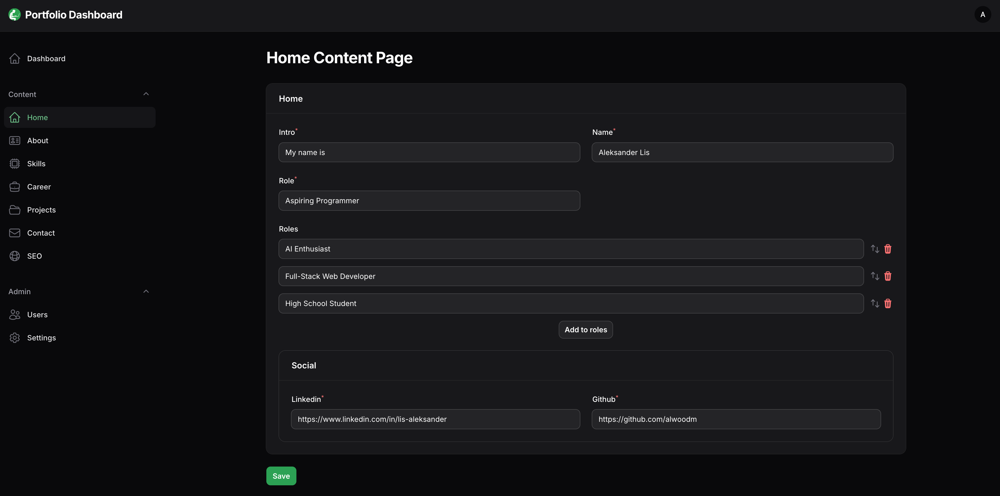

<div align="center">

# Portfolio Dashboard

A Filament-powered dashboard for editing [Portfolio](https://github.com/alwoodm/portfolio) content.



<p>
  
  
  
  <br />
  
  
  
</p>
<p>
  
  
</p>

</div>

## 📌 Overview
Portfolio Dashboard is a small admin panel built to update the [portfolio](https://github.com/alwoodm/portfolio) site without touching source files. It reads content from the [portfolio](https://github.com/alwoodm/portfolio) JSON endpoints, presents structured editors for each section, and posts updates back through a secured API token. Viewer mode provides read-only access for sharing the dashboard without exposing write permissions.

## 🛠️ Local Setup
1. Clone the repository and enter the directory:
   ```bash
   git clone https://github.com/alwoodm/portfolio-dashboard.git
   cd portfolio-dashboard
   ```
2. Install dependencies:
   ```bash
   composer install
   npm install
   ```
3. Create the environment file:
   ```bash
   cp .env.example .env
   php artisan key:generate
   ```
4. Configure required env vars:
   - `PORTFOLIO_URL=https://portfolio.example.com`
   - `PORTFOLIO_ADMIN_TOKEN=your-token`
   - `PORTFOLIO_CONTENT_PREFIX=/api/content`
5. Prepare the database:
   ```bash
   touch database/database.sqlite
   php artisan migrate
   ```
6. Build assets:
   ```bash
   npm run build
   ```
7. Run the app:
   ```bash
   composer run dev
   ```

## 🚀 Production (Docker)
1. Create a production `.env` with real values:
   ```bash
   cp .env.example .env
   APP_ENV=production
   APP_DEBUG=false
   APP_URL=https://dashboard.example.com
   APP_KEY=base64:your-generated-key
   DB_CONNECTION=sqlite
   SESSION_DRIVER=database
   CACHE_STORE=database
   PORTFOLIO_URL=https://portfolio.example.com
   PORTFOLIO_ADMIN_TOKEN=your-token
   PORTFOLIO_CONTENT_PREFIX=/api/content
   ```
   Generate the key locally with:
   ```bash
   php artisan key:generate --show
   ```
2. Build and run the container:
   ```bash
   docker-compose up --build
   ```
   The container creates the SQLite database, runs migrations, builds assets, and starts the app.

## ⚙️ Development Commands
```bash
composer run dev
composer run test
composer run lint
composer run format
npm run dev
```

## 📄 License
This project is licensed the same as the [Portfolio](https://github.com/alwoodm/portfolio) project: [MIT](LICENSE).
